<!-- Generated by scripts/build.py from data/profile.toml. Edit the data, not this file. -->

# Verification Vault

> **74 credentials across 7 ecosystems.** Every tile opens the issuer's own live verification page, so nothing here has to be taken on trust.

[← Back to profile](./README.md) · [Credly profile](https://www.credly.com/users/anupam_roy/) · [Portfolio](https://anupam-roy.vercel.app/)

<a href="#how-to-read-the-table">
<picture>
  <source media="(prefers-color-scheme: dark)" srcset="./assets/mastery-dark.svg">
  <source media="(prefers-color-scheme: light)" srcset="./assets/mastery-light.svg">
  
</picture>
</a>

<strong>Microsoft</strong> 45 · <strong>Google Cloud</strong> 14 · <strong>Snowflake</strong> 7 · <strong>AWS</strong> 3 · <strong>Databricks</strong> 2 · <strong>Anthropic</strong> 1 · <strong>MongoDB</strong> 1

## How to read the table

Credentials are placed like elements: **the lightest are fundamentals, the heaviest are expert-level**. The number on each tile is its place in the table, the code is the exam or common abbreviation, and the colour is the issuer. Tap any tile below to verify it with the issuer.

### Expert · 5

<a href="https://learn.microsoft.com/api/credentials/share/en-us/RoyAnupam-9387/697885B17EC9F884?sharingId=87E510F2D20A449" title="Dynamics 365 Finance &amp; Operations Solution Architect Expert">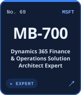</a>
<a href="https://learn.microsoft.com/api/credentials/share/en-us/RoyAnupam-9387/75D421519F179C98?sharingId=87E510F2D20A449" title="Power Platform Solution Architect Expert">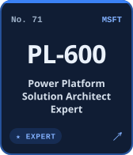</a>
<a href="https://learn.microsoft.com/api/credentials/share/en-us/RoyAnupam-9387/14B72377FE073413?sharingId=87E510F2D20A449" title="DevOps Engineer Expert">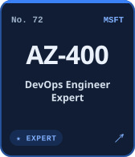</a>
<a href="https://learn.microsoft.com/api/credentials/share/en-us/RoyAnupam-9387/B707C966F0C9C77D?sharingId=87E510F2D20A449" title="Cybersecurity Architect Expert">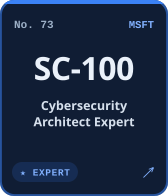</a>
<a href="https://learn.microsoft.com/api/credentials/share/en-us/RoyAnupam-9387/B178CAC5C8FCAD0C?sharingId=87E510F2D20A449" title="Azure Solutions Architect Expert">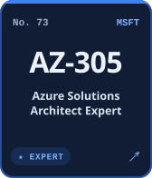</a>

### Professional & Advanced · 14

<a href="https://www.credly.com/badges/f486243e-ddce-4a98-bb96-20a7b54f9f1b/public_url" title="Professional Cloud Architect">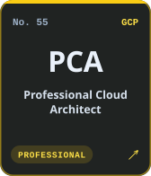</a>
<a href="https://www.credly.com/badges/877f3676-e647-4df5-8845-f566ea7f0c1e/public_url" title="Professional Machine Learning Engineer">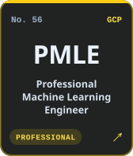</a>
<a href="https://www.credly.com/badges/50633dd1-dc56-4984-9d20-9486b16899c1/public_url" title="Professional Data Engineer">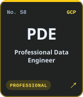</a>
<a href="https://www.credly.com/badges/e6067b76-8cf4-4238-800a-15771a747efd/public_url" title="Professional Cloud Developer">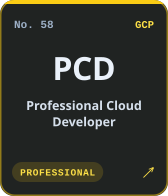</a>
<a href="https://www.credly.com/badges/7cefb295-0790-4b38-bfc7-9876bc521e98/public_url" title="Professional Cloud DevOps Engineer">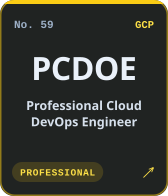</a>
<a href="https://www.credly.com/badges/62add79a-0e68-4fe1-97c4-00ad9f427255/public_url" title="Professional Cloud Network Engineer">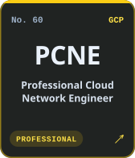</a>
<a href="https://www.credly.com/badges/cb951777-bbbc-4a04-a44e-38b3e4409cb0/public_url" title="Professional Cloud Security Engineer">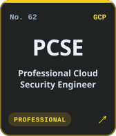</a>
<a href="https://www.credly.com/badges/8d3b2f12-fab4-4a12-8a27-3e6a7447fdce/public_url" title="Professional Cloud Database Engineer">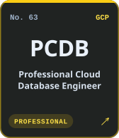</a>
<a href="https://www.credly.com/badges/609ea3c1-a21c-406b-aaea-58b0a4942e95/public_url" title="Professional Google Workspace Administrator">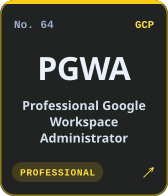</a>
<a href="https://achieve.snowflake.com/9d19adca-a1d8-4d05-8f0c-fd22356797aa" title="SnowPro Advanced: Architect">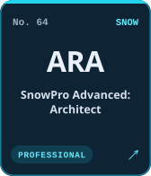</a>
<a href="https://achieve.snowflake.com/b30b4566-d900-4322-aa31-9f3568ed4174" title="SnowPro Advanced: Administrator">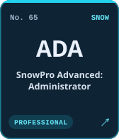</a>
<a href="https://achieve.snowflake.com/40d34f67-48bf-4f40-ad5b-6623f83d3048" title="SnowPro Advanced: Data Engineer">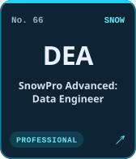</a>
<a href="https://achieve.snowflake.com/129c01d8-d301-4963-baa8-e22646cbf6c0" title="SnowPro Advanced: Data Scientist">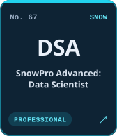</a>
<a href="https://achieve.snowflake.com/2a08d55e-22db-465d-98e9-95962e951a05" title="SnowPro Advanced: Data Analyst">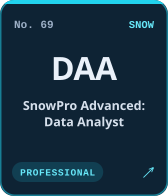</a>

### Specialty · 4

<a href="https://www.credly.com/badges/ff0365d6-a240-46a2-888b-fb72c0d9c8d6/public_url" title="AWS Certified Advanced Networking – Specialty">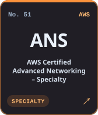</a>
<a href="https://achieve.snowflake.com/aec2a575-7ec6-4c11-8a46-b064fd0a7c10" title="SnowPro Specialty: Gen AI">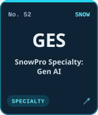</a>
<a href="https://learn.microsoft.com/api/credentials/share/en-us/RoyAnupam-9387/C3CD90E1334A3D6A?sharingId=87E510F2D20A449" title="Azure Virtual Desktop Specialty">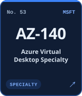</a>
<a href="https://learn.microsoft.com/api/credentials/share/en-us/RoyAnupam-9387/81A6AF64F2666BCD?sharingId=87E510F2D20A449" title="Azure Cosmos DB Developer Specialty">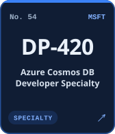</a>

### Associate · 39

<a href="https://www.credly.com/badges/abba82dd-73e2-46b7-967c-2ddbbfe40126/public_url" title="AWS Certified Machine Learning Engineer – Associate">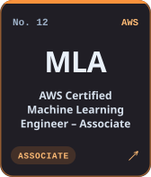</a>
<a href="https://verify.skilljar.com/c/v3bg7pbc87fn" title="Claude Certified Architect – Foundations">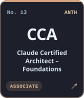</a>
<a href="https://credentials.databricks.com/65e9a608-48dd-43e8-8f63-134231a861a3" title="Databricks Certified Generative AI Engineer Associate">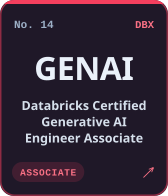</a>
<a href="https://credentials.databricks.com/42c2f101-be3c-4ecc-8ae4-ab4959b14ef7" title="Databricks Certified Data Engineer Associate">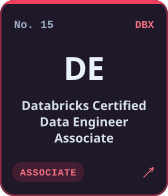</a>
<a href="https://www.credly.com/badges/3b6ff1dd-7e4d-4763-8ae9-72df6a479cdf/public_url" title="Associate Cloud Engineer">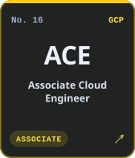</a>
<a href="https://www.credly.com/badges/34d0cf23-4279-42df-b258-ca2fc211e987/public_url" title="Associate Data Practitioner">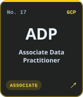</a>
<a href="https://www.credly.com/badges/080d4d45-da7e-4ec9-9591-0eb283887c28/public_url" title="Associate Google Workspace Administrator">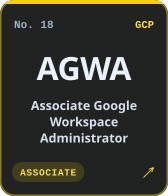</a>
<a href="https://achieve.snowflake.com/e0f74ad0-0363-43d3-b15a-d3a1457dd03b#acc.kGox1lnU" title="SnowPro Core Certification">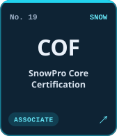</a>
<a href="https://learn.mongodb.com/c/aPi3OPbHRg2Fvwa6oyV8Vw" title="MongoDB SI Associate">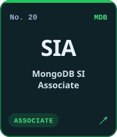</a>
<a href="https://learn.microsoft.com/api/credentials/share/en-us/RoyAnupam-9387/B62389D156A906D1?sharingId=87E510F2D20A449" title="Azure AI Engineer Associate">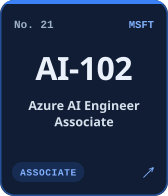</a>
<a href="https://learn.microsoft.com/api/credentials/share/en-us/RoyAnupam-9387/2434178B458695AA?sharingId=87E510F2D20A449" title="Azure Data Scientist Associate">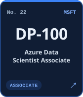</a>
<a href="https://learn.microsoft.com/api/credentials/share/en-us/RoyAnupam-9387/F4744DA45C602D5B?sharingId=87E510F2D20A449" title="Azure Data Engineer Associate">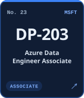</a>
<a href="https://learn.microsoft.com/api/credentials/share/en-us/RoyAnupam-9387/74F205608A5B279B?sharingId=87E510F2D20A449" title="Azure Database Administrator Associate">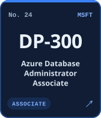</a>
<a href="https://learn.microsoft.com/api/credentials/share/en-us/RoyAnupam-9387/E76B513C89A774DD?sharingId=87E510F2D20A449" title="Azure Enterprise Data Analyst Associate">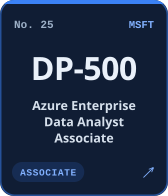</a>
<a href="https://learn.microsoft.com/api/credentials/share/en-us/RoyAnupam-9387/515934CFC19A811A?sharingId=87E510F2D20A449" title="Fabric Analytics Engineer Associate">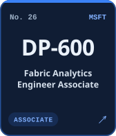</a>
<a href="https://learn.microsoft.com/api/credentials/share/en-us/RoyAnupam-9387/DE7D499CB93F5234?sharingId=87E510F2D20A449" title="Fabric Data Engineer Associate">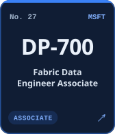</a>
<a href="https://learn.microsoft.com/api/credentials/share/en-us/RoyAnupam-9387/F976A67D15231691?sharingId=87E510F2D20A449" title="Power BI Data Analyst Associate">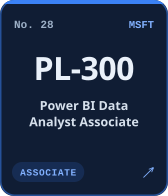</a>
<a href="https://learn.microsoft.com/api/credentials/share/en-us/RoyAnupam-9387/445CD37E604797D9?sharingId=87E510F2D20A449" title="Azure Administrator Associate">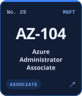</a>
<a href="https://learn.microsoft.com/api/credentials/share/en-us/RoyAnupam-9387/DF038873E69AA2FA?sharingId=87E510F2D20A449" title="Azure Developer Associate">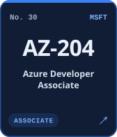</a>
<a href="https://learn.microsoft.com/api/credentials/share/en-us/RoyAnupam-9387/76D7ADA80914D779?sharingId=87E510F2D20A449" title="Azure Security Engineer Associate">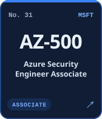</a>
<a href="https://learn.microsoft.com/api/credentials/share/en-us/RoyAnupam-9387/7678A0CA1AC224F4?sharingId=87E510F2D20A449" title="Azure Network Engineer Associate">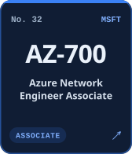</a>
<a href="https://learn.microsoft.com/api/credentials/share/en-us/RoyAnupam-9387/F354DB29B5CA74B9?sharingId=87E510F2D20A449" title="Windows Server Hybrid Administrator Associate">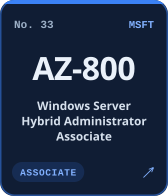</a>
<a href="https://learn.microsoft.com/api/credentials/share/en-us/RoyAnupam-9387/F4412113A1DAADE6?sharingId=87E510F2D20A449" title="Security Operations Analyst Associate">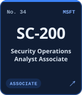</a>
<a href="https://learn.microsoft.com/api/credentials/share/en-us/RoyAnupam-9387/E0248AAEFB53BC67?sharingId=87E510F2D20A449" title="Identity and Access Administrator Associate">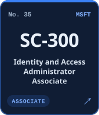</a>
<a href="https://learn.microsoft.com/api/credentials/share/en-us/RoyAnupam-9387/B49B4521EE339D35?sharingId=87E510F2D20A449" title="Information Protection &amp; Compliance Administrator">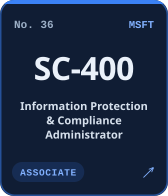</a>
<a href="https://learn.microsoft.com/api/credentials/share/en-us/RoyAnupam-9387/5B5E772E75E60D61?sharingId=87E510F2D20A449" title="Microsoft 365 Endpoint Administrator Associate">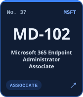</a>
<a href="https://learn.microsoft.com/api/credentials/share/en-us/RoyAnupam-9387/68EAD72ACE8F283B?sharingId=87E510F2D20A449" title="Microsoft 365 Teams Administrator Associate">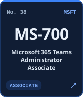</a>

### Fundamentals · 11

### No. 74 · link pending

The portfolio holds 74 PDF-backed credentials; 73 have public issuer links listed here. No. 74 appears once its link is added to `data/profile.toml`.

## Full index

<strong>All 74 credentials in one table</strong> (with the file names used for PDFs)

| No. | Code | Credential | Issuer | Level | Verify | PDF |
| ---: | --- | --- | --- | --- | --- | --- |
| 1 | `AZ-900` | Azure Fundamentals | Microsoft | Fundamentals | [verify ↗](https://learn.microsoft.com/api/credentials/share/en-us/RoyAnupam-9387/B120773C1846A17?sharingId=87E510F2D20A449) | `az-900.pdf` |
| 2 | `AI-900` | Azure AI Fundamentals | Microsoft | Fundamentals | [verify ↗](https://learn.microsoft.com/api/credentials/share/en-us/RoyAnupam-9387/1CFE13ABC4888ED6?sharingId=87E510F2D20A449) | `ai-900.pdf` |
| 3 | `DP-900` | Azure Data Fundamentals | Microsoft | Fundamentals | [verify ↗](https://learn.microsoft.com/api/credentials/share/en-us/RoyAnupam-9387/3884E398D8364524?sharingId=87E510F2D20A449) | `dp-900.pdf` |
| 4 | `SC-900` | Security, Compliance & Identity Fundamentals | Microsoft | Fundamentals | [verify ↗](https://learn.microsoft.com/api/credentials/share/en-us/RoyAnupam-9387/FBF4BC569BB1E212?sharingId=87E510F2D20A449) | `sc-900.pdf` |
| 5 | `PL-900` | Power Platform Fundamentals | Microsoft | Fundamentals | [verify ↗](https://learn.microsoft.com/api/credentials/share/en-us/RoyAnupam-9387/63CE8D63F6154129?sharingId=87E510F2D20A449) | `pl-900.pdf` |
| 6 | `MS-900` | Microsoft 365 Fundamentals | Microsoft | Fundamentals | [verify ↗](https://learn.microsoft.com/api/credentials/share/en-us/RoyAnupam-9387/2E020411669424B5?sharingId=87E510F2D20A449) | `ms-900.pdf` |
| 7 | `MB-910` | Dynamics 365 Fundamentals (CRM) | Microsoft | Fundamentals | [verify ↗](https://learn.microsoft.com/api/credentials/share/en-us/RoyAnupam-9387/3CB039D711EC3B20?sharingId=87E510F2D20A449) | `mb-910.pdf` |
| 8 | `MB-920` | Dynamics 365 Fundamentals (ERP) | Microsoft | Fundamentals | [verify ↗](https://learn.microsoft.com/api/credentials/share/en-us/RoyAnupam-9387/A84FD8DAFD442D14?sharingId=87E510F2D20A449) | `mb-920.pdf` |
| 9 | `CLF` | AWS Certified Cloud Practitioner | AWS | Fundamentals | [verify ↗](https://www.credly.com/badges/c66f5645-8a07-449d-b2ac-7629e892702a/public_url) | `aws-clf.pdf` |
| 10 | `CDL` | Cloud Digital Leader | Google Cloud | Fundamentals | [verify ↗](https://www.credly.com/badges/fc7bde6f-a96b-4ab8-846d-ef8c22cf11b7/public_url) | `gcp-cdl.pdf` |
| 11 | `GAIL` | Generative AI Leader | Google Cloud | Fundamentals | [verify ↗](https://www.credly.com/badges/4b01e73a-8e53-4d6c-97ed-c0a249b4e086/public_url) | `gcp-gail.pdf` |
| 12 | `MLA` | AWS Certified Machine Learning Engineer – Associate | AWS | Associate | [verify ↗](https://www.credly.com/badges/abba82dd-73e2-46b7-967c-2ddbbfe40126/public_url) | `aws-mla.pdf` |
| 13 | `CCA` | Claude Certified Architect – Foundations | Anthropic | Associate | [verify ↗](https://verify.skilljar.com/c/v3bg7pbc87fn) | `claude-architect.pdf` |
| 14 | `GENAI` | Databricks Certified Generative AI Engineer Associate | Databricks | Associate | [verify ↗](https://credentials.databricks.com/65e9a608-48dd-43e8-8f63-134231a861a3) | `databricks-genai.pdf` |
| 15 | `DE` | Databricks Certified Data Engineer Associate | Databricks | Associate | [verify ↗](https://credentials.databricks.com/42c2f101-be3c-4ecc-8ae4-ab4959b14ef7) | `databricks-de.pdf` |
| 16 | `ACE` | Associate Cloud Engineer | Google Cloud | Associate | [verify ↗](https://www.credly.com/badges/3b6ff1dd-7e4d-4763-8ae9-72df6a479cdf/public_url) | `gcp-ace.pdf` |
| 17 | `ADP` | Associate Data Practitioner | Google Cloud | Associate | [verify ↗](https://www.credly.com/badges/34d0cf23-4279-42df-b258-ca2fc211e987/public_url) | `gcp-adp.pdf` |
| 18 | `AGWA` | Associate Google Workspace Administrator | Google Cloud | Associate | [verify ↗](https://www.credly.com/badges/080d4d45-da7e-4ec9-9591-0eb283887c28/public_url) | `gcp-agwa.pdf` |
| 19 | `COF` | SnowPro Core Certification | Snowflake | Associate | [verify ↗](https://achieve.snowflake.com/e0f74ad0-0363-43d3-b15a-d3a1457dd03b#acc.kGox1lnU) | `snowpro-core.pdf` |
| 20 | `SIA` | MongoDB SI Associate | MongoDB | Associate | [verify ↗](https://learn.mongodb.com/c/aPi3OPbHRg2Fvwa6oyV8Vw) | `mongodb-si.pdf` |
| 21 | `AI-102` | Azure AI Engineer Associate | Microsoft | Associate | [verify ↗](https://learn.microsoft.com/api/credentials/share/en-us/RoyAnupam-9387/B62389D156A906D1?sharingId=87E510F2D20A449) | `ai-102.pdf` |
| 22 | `DP-100` | Azure Data Scientist Associate | Microsoft | Associate | [verify ↗](https://learn.microsoft.com/api/credentials/share/en-us/RoyAnupam-9387/2434178B458695AA?sharingId=87E510F2D20A449) | `dp-100.pdf` |
| 23 | `DP-203` | Azure Data Engineer Associate | Microsoft | Associate | [verify ↗](https://learn.microsoft.com/api/credentials/share/en-us/RoyAnupam-9387/F4744DA45C602D5B?sharingId=87E510F2D20A449) | `dp-203.pdf` |
| 24 | `DP-300` | Azure Database Administrator Associate | Microsoft | Associate | [verify ↗](https://learn.microsoft.com/api/credentials/share/en-us/RoyAnupam-9387/74F205608A5B279B?sharingId=87E510F2D20A449) | `dp-300.pdf` |
| 25 | `DP-500` | Azure Enterprise Data Analyst Associate | Microsoft | Associate | [verify ↗](https://learn.microsoft.com/api/credentials/share/en-us/RoyAnupam-9387/E76B513C89A774DD?sharingId=87E510F2D20A449) | `dp-500.pdf` |
| 26 | `DP-600` | Fabric Analytics Engineer Associate | Microsoft | Associate | [verify ↗](https://learn.microsoft.com/api/credentials/share/en-us/RoyAnupam-9387/515934CFC19A811A?sharingId=87E510F2D20A449) | `dp-600.pdf` |
| 27 | `DP-700` | Fabric Data Engineer Associate | Microsoft | Associate | [verify ↗](https://learn.microsoft.com/api/credentials/share/en-us/RoyAnupam-9387/DE7D499CB93F5234?sharingId=87E510F2D20A449) | `dp-700.pdf` |
| 28 | `PL-300` | Power BI Data Analyst Associate | Microsoft | Associate | [verify ↗](https://learn.microsoft.com/api/credentials/share/en-us/RoyAnupam-9387/F976A67D15231691?sharingId=87E510F2D20A449) | `pl-300.pdf` |
| 29 | `AZ-104` | Azure Administrator Associate | Microsoft | Associate | [verify ↗](https://learn.microsoft.com/api/credentials/share/en-us/RoyAnupam-9387/445CD37E604797D9?sharingId=87E510F2D20A449) | `az-104.pdf` |
| 30 | `AZ-204` | Azure Developer Associate | Microsoft | Associate | [verify ↗](https://learn.microsoft.com/api/credentials/share/en-us/RoyAnupam-9387/DF038873E69AA2FA?sharingId=87E510F2D20A449) | `az-204.pdf` |
| 31 | `AZ-500` | Azure Security Engineer Associate | Microsoft | Associate | [verify ↗](https://learn.microsoft.com/api/credentials/share/en-us/RoyAnupam-9387/76D7ADA80914D779?sharingId=87E510F2D20A449) | `az-500.pdf` |
| 32 | `AZ-700` | Azure Network Engineer Associate | Microsoft | Associate | [verify ↗](https://learn.microsoft.com/api/credentials/share/en-us/RoyAnupam-9387/7678A0CA1AC224F4?sharingId=87E510F2D20A449) | `az-700.pdf` |
| 33 | `AZ-800` | Windows Server Hybrid Administrator Associate | Microsoft | Associate | [verify ↗](https://learn.microsoft.com/api/credentials/share/en-us/RoyAnupam-9387/F354DB29B5CA74B9?sharingId=87E510F2D20A449) | `az-800.pdf` |
| 34 | `SC-200` | Security Operations Analyst Associate | Microsoft | Associate | [verify ↗](https://learn.microsoft.com/api/credentials/share/en-us/RoyAnupam-9387/F4412113A1DAADE6?sharingId=87E510F2D20A449) | `sc-200.pdf` |
| 35 | `SC-300` | Identity and Access Administrator Associate | Microsoft | Associate | [verify ↗](https://learn.microsoft.com/api/credentials/share/en-us/RoyAnupam-9387/E0248AAEFB53BC67?sharingId=87E510F2D20A449) | `sc-300.pdf` |
| 36 | `SC-400` | Information Protection & Compliance Administrator | Microsoft | Associate | [verify ↗](https://learn.microsoft.com/api/credentials/share/en-us/RoyAnupam-9387/B49B4521EE339D35?sharingId=87E510F2D20A449) | `sc-400.pdf` |
| 37 | `MD-102` | Microsoft 365 Endpoint Administrator Associate | Microsoft | Associate | [verify ↗](https://learn.microsoft.com/api/credentials/share/en-us/RoyAnupam-9387/5B5E772E75E60D61?sharingId=87E510F2D20A449) | `md-102.pdf` |
| 38 | `MS-700` | Microsoft 365 Teams Administrator Associate | Microsoft | Associate | [verify ↗](https://learn.microsoft.com/api/credentials/share/en-us/RoyAnupam-9387/68EAD72ACE8F283B?sharingId=87E510F2D20A449) | `ms-700.pdf` |
| 39 | `GH-300` | GitHub Copilot | Microsoft | Associate | [verify ↗](https://learn.microsoft.com/api/credentials/share/en-us/RoyAnupam-9387/744029EEBC8C6F59?sharingId=87E510F2D20A449) | `gh-300.pdf` |
| 40 | `PL-100` | Power Platform App Maker Associate | Microsoft | Associate | [verify ↗](https://learn.microsoft.com/api/credentials/share/en-us/RoyAnupam-9387/6B7F7727DABB1A41?sharingId=87E510F2D20A449) | `pl-100.pdf` |
| 41 | `PL-200` | Power Platform Functional Consultant Associate | Microsoft | Associate | [verify ↗](https://learn.microsoft.com/api/credentials/share/en-us/RoyAnupam-9387/9D452055BE1056D?sharingId=87E510F2D20A449) | `pl-200.pdf` |
| 42 | `PL-400` | Power Platform Developer Associate | Microsoft | Associate | [verify ↗](https://learn.microsoft.com/api/credentials/share/en-us/RoyAnupam-9387/13E943893C5FB917?sharingId=87E510F2D20A449) | `pl-400.pdf` |
| 43 | `MB-210` | Dynamics 365 Sales Functional Consultant Associate | Microsoft | Associate | [verify ↗](https://learn.microsoft.com/api/credentials/share/en-us/RoyAnupam-9387/6EBEF3ED62A76AEA?sharingId=87E510F2D20A449) | `mb-210.pdf` |
| 44 | `MB-220` | Dynamics 365 Customer Insights Functional Consultant | Microsoft | Associate | [verify ↗](https://learn.microsoft.com/api/credentials/share/en-us/RoyAnupam-9387/B81C87BBC8A3E9F9?sharingId=87E510F2D20A449) | `mb-220.pdf` |
| 45 | `MB-230` | Dynamics 365 Customer Service Functional Consultant | Microsoft | Associate | [verify ↗](https://learn.microsoft.com/api/credentials/share/en-us/RoyAnupam-9387/C3AEE54273511B98?sharingId=87E510F2D20A449) | `mb-230.pdf` |
| 46 | `MB-240` | Dynamics 365 Field Service Functional Consultant | Microsoft | Associate | [verify ↗](https://learn.microsoft.com/api/credentials/share/en-us/RoyAnupam-9387/B2E007F3F5999476?sharingId=87E510F2D20A449) | `mb-240.pdf` |
| 47 | `MB-310` | Dynamics 365 Finance Functional Consultant | Microsoft | Associate | [verify ↗](https://learn.microsoft.com/api/credentials/share/en-us/RoyAnupam-9387/58D65B031FB1E141?sharingId=87E510F2D20A449) | `mb-310.pdf` |
| 48 | `MB-330` | Dynamics 365 Supply Chain Management Functional Consultant | Microsoft | Associate | [verify ↗](https://learn.microsoft.com/api/credentials/share/en-us/RoyAnupam-9387/F4D9F0C46CB8C683?sharingId=87E510F2D20A449) | `mb-330.pdf` |
| 49 | `MB-500` | Dynamics 365 Finance & Operations Apps Developer Associate | Microsoft | Associate | [verify ↗](https://learn.microsoft.com/api/credentials/share/en-us/RoyAnupam-9387/8FAD447A2EE7438F?sharingId=87E510F2D20A449) | `mb-500.pdf` |
| 50 | `MB-800` | Dynamics 365 Business Central Functional Consultant | Microsoft | Associate | [verify ↗](https://learn.microsoft.com/api/credentials/share/en-us/RoyAnupam-9387/E90891A2F0C3A510?sharingId=87E510F2D20A449) | `mb-800.pdf` |
| 51 | `ANS` | AWS Certified Advanced Networking – Specialty | AWS | Specialty | [verify ↗](https://www.credly.com/badges/ff0365d6-a240-46a2-888b-fb72c0d9c8d6/public_url) | `aws-ans.pdf` |
| 52 | `GES` | SnowPro Specialty: Gen AI | Snowflake | Specialty | [verify ↗](https://achieve.snowflake.com/aec2a575-7ec6-4c11-8a46-b064fd0a7c10) | `snowpro-genai.pdf` |
| 53 | `AZ-140` | Azure Virtual Desktop Specialty | Microsoft | Specialty | [verify ↗](https://learn.microsoft.com/api/credentials/share/en-us/RoyAnupam-9387/C3CD90E1334A3D6A?sharingId=87E510F2D20A449) | `az-140.pdf` |
| 54 | `DP-420` | Azure Cosmos DB Developer Specialty | Microsoft | Specialty | [verify ↗](https://learn.microsoft.com/api/credentials/share/en-us/RoyAnupam-9387/81A6AF64F2666BCD?sharingId=87E510F2D20A449) | `dp-420.pdf` |
| 55 | `PCA` | Professional Cloud Architect | Google Cloud | Professional | [verify ↗](https://www.credly.com/badges/f486243e-ddce-4a98-bb96-20a7b54f9f1b/public_url) | `gcp-pca.pdf` |
| 56 | `PMLE` | Professional Machine Learning Engineer | Google Cloud | Professional | [verify ↗](https://www.credly.com/badges/877f3676-e647-4df5-8845-f566ea7f0c1e/public_url) | `gcp-pmle.pdf` |
| 57 | `PDE` | Professional Data Engineer | Google Cloud | Professional | [verify ↗](https://www.credly.com/badges/50633dd1-dc56-4984-9d20-9486b16899c1/public_url) | `gcp-pde.pdf` |
| 58 | `PCD` | Professional Cloud Developer | Google Cloud | Professional | [verify ↗](https://www.credly.com/badges/e6067b76-8cf4-4238-800a-15771a747efd/public_url) | `gcp-pcd.pdf` |
| 59 | `PCDOE` | Professional Cloud DevOps Engineer | Google Cloud | Professional | [verify ↗](https://www.credly.com/badges/7cefb295-0790-4b38-bfc7-9876bc521e98/public_url) | `gcp-pcdoe.pdf` |
| 60 | `PCNE` | Professional Cloud Network Engineer | Google Cloud | Professional | [verify ↗](https://www.credly.com/badges/62add79a-0e68-4fe1-97c4-00ad9f427255/public_url) | `gcp-pcne.pdf` |
| 61 | `PCSE` | Professional Cloud Security Engineer | Google Cloud | Professional | [verify ↗](https://www.credly.com/badges/cb951777-bbbc-4a04-a44e-38b3e4409cb0/public_url) | `gcp-pcse.pdf` |
| 62 | `PCDB` | Professional Cloud Database Engineer | Google Cloud | Professional | [verify ↗](https://www.credly.com/badges/8d3b2f12-fab4-4a12-8a27-3e6a7447fdce/public_url) | `gcp-pcdb.pdf` |
| 63 | `PGWA` | Professional Google Workspace Administrator | Google Cloud | Professional | [verify ↗](https://www.credly.com/badges/609ea3c1-a21c-406b-aaea-58b0a4942e95/public_url) | `gcp-pgwa.pdf` |
| 64 | `ARA` | SnowPro Advanced: Architect | Snowflake | Professional | [verify ↗](https://achieve.snowflake.com/9d19adca-a1d8-4d05-8f0c-fd22356797aa) | `snowpro-architect.pdf` |
| 65 | `ADA` | SnowPro Advanced: Administrator | Snowflake | Professional | [verify ↗](https://achieve.snowflake.com/b30b4566-d900-4322-aa31-9f3568ed4174) | `snowpro-admin.pdf` |
| 66 | `DEA` | SnowPro Advanced: Data Engineer | Snowflake | Professional | [verify ↗](https://achieve.snowflake.com/40d34f67-48bf-4f40-ad5b-6623f83d3048) | `snowpro-data-engineer.pdf` |
| 67 | `DSA` | SnowPro Advanced: Data Scientist | Snowflake | Professional | [verify ↗](https://achieve.snowflake.com/129c01d8-d301-4963-baa8-e22646cbf6c0) | `snowpro-data-scientist.pdf` |
| 68 | `DAA` | SnowPro Advanced: Data Analyst | Snowflake | Professional | [verify ↗](https://achieve.snowflake.com/2a08d55e-22db-465d-98e9-95962e951a05) | `snowpro-data-analyst.pdf` |
| 69 | `MB-700` | Dynamics 365 Finance & Operations Solution Architect Expert | Microsoft | Expert | [verify ↗](https://learn.microsoft.com/api/credentials/share/en-us/RoyAnupam-9387/697885B17EC9F884?sharingId=87E510F2D20A449) | `mb-700.pdf` |
| 70 | `PL-600` | Power Platform Solution Architect Expert | Microsoft | Expert | [verify ↗](https://learn.microsoft.com/api/credentials/share/en-us/RoyAnupam-9387/75D421519F179C98?sharingId=87E510F2D20A449) | `pl-600.pdf` |
| 71 | `AZ-400` | DevOps Engineer Expert | Microsoft | Expert | [verify ↗](https://learn.microsoft.com/api/credentials/share/en-us/RoyAnupam-9387/14B72377FE073413?sharingId=87E510F2D20A449) | `az-400.pdf` |
| 72 | `SC-100` | Cybersecurity Architect Expert | Microsoft | Expert | [verify ↗](https://learn.microsoft.com/api/credentials/share/en-us/RoyAnupam-9387/B707C966F0C9C77D?sharingId=87E510F2D20A449) | `sc-100.pdf` |
| 73 | `AZ-305` | Azure Solutions Architect Expert | Microsoft | Expert | [verify ↗](https://learn.microsoft.com/api/credentials/share/en-us/RoyAnupam-9387/B178CAC5C8FCAD0C?sharingId=87E510F2D20A449) | `az-305.pdf` |
| 74 | — | Credential No. 74 | — | — | pending | — |

## Adding certificate PDFs

1. Save each certificate as `certificates/<file name>.pdf`, using the file name from the index above.
2. Run `python3 scripts/build.py`. The index switches that row to a **PDF** link automatically.
3. Commit the PDFs together with the regenerated files.

> The issuer link stays the source of truth; a PDF is supporting evidence, not the verifier.
