<!--
  Profile README for github.com/Anupam0202
  The images in assets/ and CERTIFICATIONS.md are generated: edit data/profile.toml,
  then run `python3 scripts/build.py`. See SETUP.md.
-->

<a href="https://anupam-roy.vercel.app/">
<picture>
  <source media="(prefers-color-scheme: dark)" srcset="./assets/hero-dark.svg">
  <source media="(prefers-color-scheme: light)" srcset="./assets/hero-light.svg">
  
</picture>
</a>

  
  
  
  
  

  <a href="#how-i-build"><b>How I build</b></a> ·
  <a href="#experience"><b>Experience</b></a> ·
  <a href="#proof-of-work"><b>Proof of work</b></a> ·
  <a href="#wall-of-mastery"><b>Wall of Mastery</b></a> ·
  <a href="#recognition"><b>Recognition</b></a> ·
  <a href="#stack"><b>Stack</b></a> ·
  <a href="#education"><b>Education</b></a>

I'm an AI/ML engineer at **Accenture** who builds production AI that **shows its evidence or says it doesn't know**. At work, that is a multi-agent GenAI platform running incident, problem, release and service-request operations. In public, it is a set of builds where models cite, verify and fail closed. Every claim on this page links to something you can check.

## How I build

Six rules that run through everything I ship, each with a repository you can audit.

<table>
<tr>
<td width="50%" valign="top">

**`01` Cite or abstain** 
An answer ships only when every claim resolves to a retrieved source. No source, no answer. 
Proof → <a href="https://github.com/Anupam0202/NexusRAG">NexusRAG</a>

</td>
<td width="50%" valign="top">

**`02` Deterministic before AI** 
Exact rules make the safety-critical call. Models extract and propose; they never decide. 
Proof → <a href="https://github.com/Anupam0202/food-bank-recall-closure-agent">Recall Closure Agent</a> · <a href="https://github.com/Anupam0202/pantryproof">PantryProof</a>

</td>
</tr>
<tr>
<td width="50%" valign="top">

**`03` Models propose, people approve** 
Agents get typed, allowlisted tools and stop at a human checkpoint before anything irreversible. 
Proof → <a href="https://github.com/Anupam0202/cutline">CUTLINE</a> · <a href="https://github.com/Anupam0202/raceproof">RaceProof</a>

</td>
<td width="50%" valign="top">

**`04` Approvals expire with the evidence** 
A review is fingerprinted to the exact revision it approved. Change the text, and the approval goes stale. 
Proof → <a href="https://github.com/Anupam0202/cutline">CUTLINE</a> · <a href="https://github.com/Anupam0202/recordcheck">RecordCheck</a>

</td>
</tr>
<tr>
<td width="50%" valign="top">

**`05` Attack it before users do** 
Red-team every guardrail, then measure the utility it costs. Safety that breaks the product is not safety. 
Proof → <a href="https://github.com/Anupam0202/boxshield-arena">BoxShield Arena</a>

</td>
<td width="50%" valign="top">

**`06` Budget every model call** 
Quotas, cooldowns and bounded retries keep AI cost predictable, and fail closed when they run out. 
Proof → <a href="https://github.com/Anupam0202/ahawin">AhaWin</a> · <a href="https://github.com/Anupam0202/NexusRAG">NexusRAG</a>

</td>
</tr>
</table>

## Experience

<picture>
  <source media="(prefers-color-scheme: dark)" srcset="./assets/timeline-dark.svg">
  <source media="(prefers-color-scheme: light)" srcset="./assets/timeline-light.svg">
  
</picture>

### AI/ML Analyst · Accenture · Dec 2023 – Present

**Built an enterprise AI operational assistant:** a production multi-agent GenAI platform that took SME-heavy production support, incident, testing and release work and handed it to specialist AI agents.

<picture>
  <source media="(prefers-color-scheme: dark)" srcset="./assets/experience-dark.svg">
  <source media="(prefers-color-scheme: light)" srcset="./assets/experience-light.svg">
  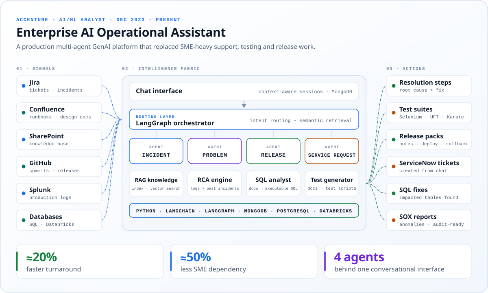
</picture>

- **Multi-agent orchestration.** Designed LangGraph workflows with incident, problem, release and service-request agents, routed dynamically by user intent and semantic retrieval.
- **Enterprise RAG.** Built indexing and retrieval pipelines over Jira, Confluence, SharePoint, GitHub, Splunk logs and databases, covering tickets, logs, documents and SQL.
- **Real-time root-cause analysis.** Correlates logs with historical incidents and writes context-grounded resolution steps: **≈20% faster turnaround** and **≈50% less SME dependency**.
- **AI test generation.** Turns design documents and existing frameworks into functional test cases and **Selenium, UFT and Karate** scripts.
- **Release intelligence.** Reads GitHub commits, Confluence and Jira to draft release notes, deployment plans and rollback strategies.
- **Operations automation.** Chat-to-ServiceNow ticket creation, docs-to-SQL analysis that pinpoints impacted tables, anomaly detection and audit-ready **SOX** reporting, all behind one context-aware chat backed by MongoDB.

<b>Stack:</b> Python · LangGraph · LangChain · RAG · vector search · MongoDB · PostgreSQL · Databricks · Jira · ServiceNow · Confluence · SharePoint · Splunk · Selenium · UFT · Karate

### Associate Software Engineer · Accenture · Aug 2022 – Nov 2023

- Built and deployed **Spring Boot / Core Java** microservices with scalable REST APIs for insurance workflows.
- Designed event-driven serverless components on **AWS Lambda**, cutting infrastructure overhead.
- Automated build, test and deploy with **CI/CD pipelines on AWS CodeBuild**, removing manual release effort.
- Raised reliability with **JUnit** unit and integration tests, and caught vulnerabilities early with **SonarQube** and **SourceClear** gates.
- Delivered in Agile Scrum and wrote the automation scripts behind a DevOps-first team.

## Proof of work

18 public builds. The newest share one idea: **models propose; deterministic code and people decide.** Test counts are read from each repository; the Proof Atlas suite was run and passed for its release.

### Flagships

<a href="https://github.com/Anupam0202/NexusRAG">
<picture>
  <source media="(prefers-color-scheme: dark)" srcset="./assets/projects/nexusrag-dark.svg">
  <source media="(prefers-color-scheme: light)" srcset="./assets/projects/nexusrag-light.svg">
  
</picture>
</a>

<a href="https://anupam-roy.vercel.app/">
<picture>
  <source media="(prefers-color-scheme: dark)" srcset="./assets/projects/proof-atlas-dark.svg">
  <source media="(prefers-color-scheme: light)" srcset="./assets/projects/proof-atlas-light.svg">
  
</picture>
</a>

  <a href="https://github.com/Anupam0202/NexusRAG"><b>NexusRAG source</b></a> ·
  <a href="https://anupam-roy.vercel.app/"><b>Proof Atlas live</b></a> ·
  <a href="https://github.com/Anupam0202/Anupam_Roy"><b>Proof Atlas source</b></a>

### Agents with guardrails

<a href="https://github.com/Anupam0202/cutline"><picture><source media="(prefers-color-scheme: dark)" srcset="./assets/projects/cutline-dark.svg">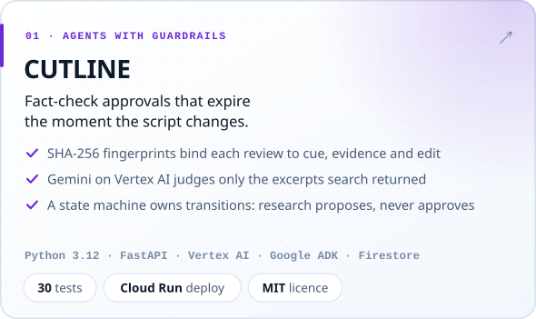</picture></a>
<a href="https://github.com/Anupam0202/food-bank-recall-closure-agent"><picture><source media="(prefers-color-scheme: dark)" srcset="./assets/projects/food-bank-recall-dark.svg">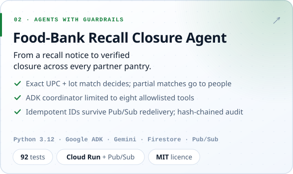</picture></a>

<a href="https://github.com/Anupam0202/raceproof"><picture><source media="(prefers-color-scheme: dark)" srcset="./assets/projects/raceproof-dark.svg">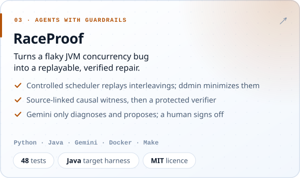</picture></a>
<a href="https://github.com/Anupam0202/boxshield-arena"><picture><source media="(prefers-color-scheme: dark)" srcset="./assets/projects/boxshield-arena-dark.svg">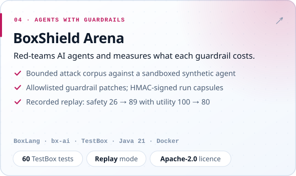</picture></a>

### Evidence-first products

<a href="https://github.com/Anupam0202/pantryproof"><picture><source media="(prefers-color-scheme: dark)" srcset="./assets/projects/pantryproof-dark.svg">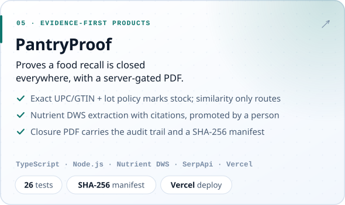</picture></a>
<a href="https://github.com/Anupam0202/ahawin"><picture><source media="(prefers-color-scheme: dark)" srcset="./assets/projects/ahawin-dark.svg">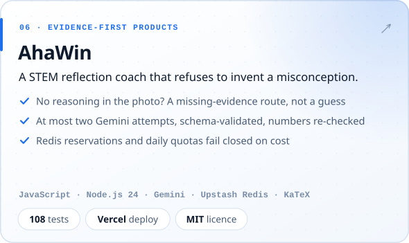</picture></a>

<a href="https://github.com/Anupam0202/PlantPal"><picture><source media="(prefers-color-scheme: dark)" srcset="./assets/projects/plantpal-dark.svg">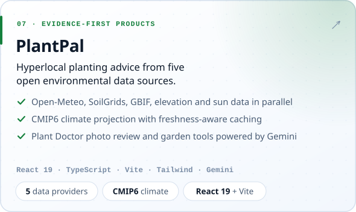</picture></a>
<a href="https://github.com/Anupam0202/mavunoguard-ai"><picture><source media="(prefers-color-scheme: dark)" srcset="./assets/projects/mavunoguard-dark.svg">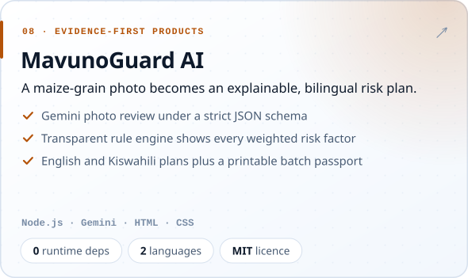</picture></a>

PantryProof also runs at <a href="https://pantryproof.vercel.app">pantryproof.vercel.app</a>.

### Retrieval lab and earlier work

| Project | What it shows | Links |
| --- | --- | --- |
| **RAG** | Gemini + LangChain + Streamlit Q&A over 7 file types; FAISS + BM25 hybrid search, chat memory, Markdown export | [Live demo](https://rag-with-langchain.streamlit.app/) · [Source](https://github.com/Anupam0202/RAG) |
| **Contextual RAG Chatbot** | PDF Q&A with Tesseract OCR fallback, tunable dense + sparse fusion, a 1–20 message context window and analytics export | [Live demo](https://contextual-rag-chatbot.streamlit.app/) · [Source](https://github.com/Anupam0202/Contextual-RAG-Chatbot) |
| **RecordCheck** | Local-only claim-versus-source review that binds sign-off to the exact revision checked; one HTML file, 43 tests | [Source](https://github.com/Anupam0202/recordcheck) |
| **Handwritten Chemical Compound Detection** | TensorFlow Object Detection (SSD EfficientDet-D0) trained on 30 hand-drawn compound classes | [Notebook](https://github.com/Anupam0202/Handwritten-Chemical_Compound-Detection/blob/main/object_detection_tutorial.ipynb) · [Source](https://github.com/Anupam0202/Handwritten-Chemical_Compound-Detection) |

<b>Where it started: 2022 frontend builds</b>

 

| Project | Stack | Links |
| --- | --- | --- |
| **My Portfolio** | Next.js 10 · React 17 · styled-components | [Live](https://portfolioanupamroy.netlify.app/) · [Source](https://github.com/Anupam0202/My-Portfolio) |
| **Anupam Portfolio** | React 17 · Create React App | [Live](https://anupamroyportfolio.netlify.app/) · [Source](https://github.com/Anupam0202/Anupam-Portfolio) |
| **Real Estate** | Next.js 11 · Chakra UI · Bayut listings API | [Live](https://real-estate-tau-ten.vercel.app/) · [Source](https://github.com/Anupam0202/Real-Estate) |
| **Modern UI/UX GPT-3** | React 17 · BEM CSS · flexbox and grid | [Live](https://anupam0202.github.io/Modern_UI-UX_GPT3/) · [Source](https://github.com/Anupam0202/Modern_UI-UX_GPT3) |

## Wall of Mastery

<a href="./CERTIFICATIONS.md">
<picture>
  <source media="(prefers-color-scheme: dark)" srcset="./assets/mastery-dark.svg">
  <source media="(prefers-color-scheme: light)" srcset="./assets/mastery-light.svg">
  
</picture>
</a>

<b>74 credentials · 7 ecosystems · 5 expert · 14 professional · all issuer-verifiable</b>

The table is ordered like the real one: **light elements are fundamentals, heavy ones are expert-level.** Element 1 is AZ-900; elements 69 to 73 are five Microsoft Expert certifications, ending with AZ-305. Tap any signature credential below to verify it now.

<a href="https://www.credly.com/badges/abba82dd-73e2-46b7-967c-2ddbbfe40126/public_url">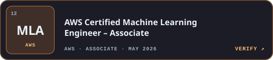</a>
<a href="https://verify.skilljar.com/c/v3bg7pbc87fn">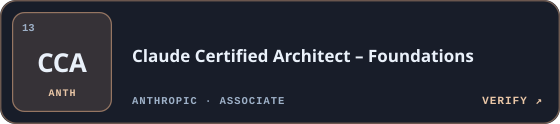</a>
<a href="https://credentials.databricks.com/65e9a608-48dd-43e8-8f63-134231a861a3">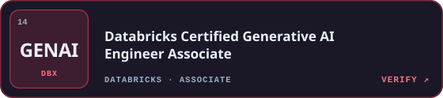</a>
<a href="https://learn.microsoft.com/api/credentials/share/en-us/RoyAnupam-9387/B62389D156A906D1?sharingId=87E510F2D20A449">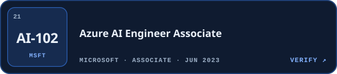</a>
<a href="https://achieve.snowflake.com/aec2a575-7ec6-4c11-8a46-b064fd0a7c10">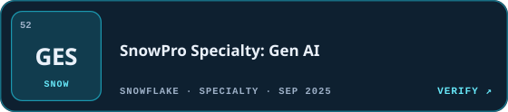</a>
<a href="https://www.credly.com/badges/f486243e-ddce-4a98-bb96-20a7b54f9f1b/public_url">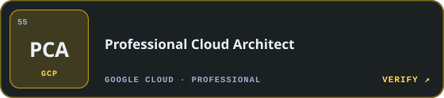</a>
<a href="https://www.credly.com/badges/877f3676-e647-4df5-8845-f566ea7f0c1e/public_url">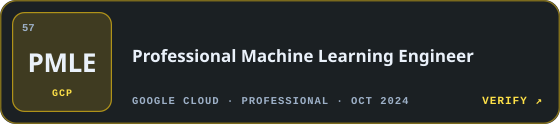</a>
<a href="https://learn.microsoft.com/api/credentials/share/en-us/RoyAnupam-9387/B178CAC5C8FCAD0C?sharingId=87E510F2D20A449">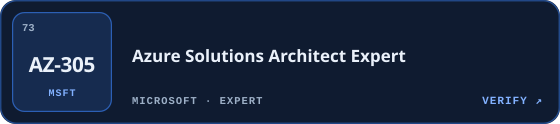</a>

<h3 align="center"><a href="./CERTIFICATIONS.md">Open the verification vault: all 74, one tap each →</a></h3>

## Recognition

<a href="https://www.credly.com/badges/3d899907-7a72-4cac-80d0-c7f80d9a892c/public_url"><picture><source media="(prefers-color-scheme: dark)" srcset="./assets/achievements/credly-top-dark.svg"></picture></a>
<a href="https://www.credly.com/users/anupam_roy/"><picture><source media="(prefers-color-scheme: dark)" srcset="./assets/achievements/badges-dark.svg"></picture></a>
<a href="https://www.linkedin.com/posts/anupam--roy_googlecloud-gcp-learninganddevelopment-activity-7385948527765639168-SuDJ"><picture><source media="(prefers-color-scheme: dark)" srcset="./assets/achievements/gcp-legend-dark.svg"></picture></a>
<a href="https://www.codechef.com/users/anupam_roy"><picture><source media="(prefers-color-scheme: dark)" srcset="./assets/achievements/codechef-dark.svg"></picture></a>

The three Google Cloud Technical Expert badges (Customer Engagement Suite with Google AI, Intelligent Search, Build with Vertex AI) came with Early Adopter recognition: <a href="https://www.linkedin.com/posts/anupam--roy_googlecloud-vertexai-accenture-activity-7367557930969182210-Goq9">read the post</a>.

## Stack

<picture>
  <source media="(prefers-color-scheme: dark)" srcset="./assets/stack-dark.svg">
  <source media="(prefers-color-scheme: light)" srcset="./assets/stack-light.svg">
  
</picture>

Cloud certifications cover AWS, Google Cloud and Azure architecture in depth. See the <a href="#wall-of-mastery">Wall of Mastery</a>.

## Education

**B.Tech, Computer Science & Engineering**: Maulana Abul Kalam Azad University of Technology, West Bengal · 2018–2022 · **GPA 9.14 / 10**

Data Structures & Algorithms · Operating Systems · Database Management Systems · Computer Networks · Machine Learning · Software Engineering · Distributed Systems

<b>School</b>

 

- **Class XII, Science** (Physics, Chemistry, Mathematics, Computer Science): Basirhat Town High School, WBCHSE · 2018 · 73%
- **Class X**: Itinda Union High School, WBBSE · 2016 · 84%

## Off the clock

Chess · cricket · BGMI `5187468970` · Clash of Clans `#92J9PUUYU` · practical problem-solving. Challenges welcome.

 

<picture>
  <source media="(prefers-color-scheme: dark)" srcset="./assets/footer-dark.svg">
  <source media="(prefers-color-scheme: light)" srcset="./assets/footer-light.svg">
  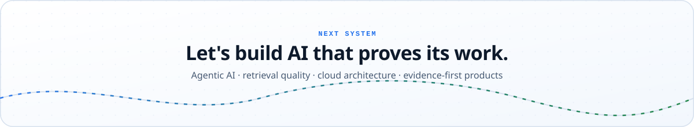
</picture>

  <a href="mailto:anupam020202@gmail.com"><b>anupam020202@gmail.com</b></a> ·
  <a href="https://anupam-roy.vercel.app/"><b>anupam-roy.vercel.app</b></a> ·
  <a href="https://www.linkedin.com/in/anupam--roy/"><b>linkedin.com/in/anupam--roy</b></a>

Repository facts reflect each project as reviewed in October 2026. Visuals are generated from <a href="./data/profile.toml">one data file</a>.

